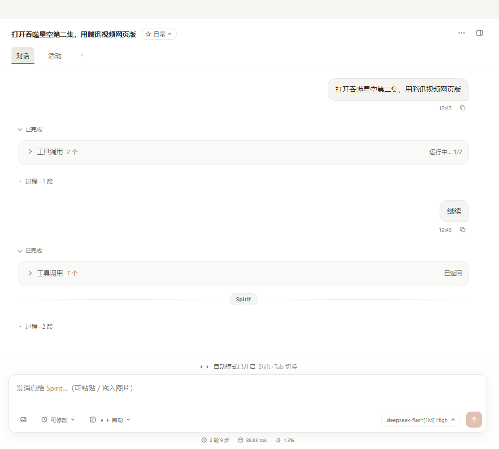
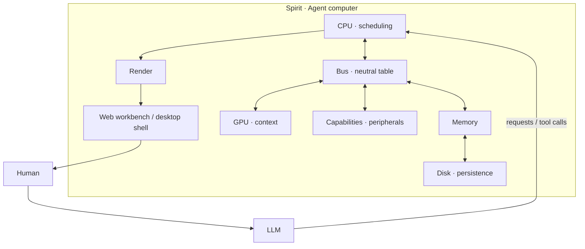

# A Garbage Agent Dev

> Internal codename **Spirit**. An agent is not "a chatbot that can call tools" — it is a general-purpose computer, where the person sitting at the keyboard is a large language model instead of a human.

[简体中文](README.md) · [Design docs](spirit/说明/Agent项目构思.md) · [Feedback](#feedback)



## What it is

Spirit is an agent runtime that treats the LLM as the **user of a computer**. Scheduling, memory, context, capabilities, rendering and persistence are independent subsystems assembled by the motherboard (Engine). Capabilities (bash, files, network, browser…) are registered, approved and audited like peripherals.

It ships with a web workbench and an Electron desktop shell, and can also run a plain terminal chat.

## Three things that make it different

| Design | What it means |
|---|---|
| **Agent = general-purpose computer** | The model is the user, not the CPU; the CPU only schedules. Subsystems communicate through a neutral bus, so replacing one part leaves the others untouched |
| **Designed for 10× load** | In-turn checkpoints, stream reconnects, hot/cold storage tiers, truly parallel sessions, bounded queues with degradation — not a demo |
| **The kernel has tests** | 100+ offline Python tests plus Playwright UI tests covering concurrency, timeouts, cancellation, corrupted config and long-running soak tests |

## Architecture



| Subsystem | Responsibility |
|---|---|
| CPU / DC | Single-threaded scheduling: state, control signals, loop |
| Bus | The only channel for exchanging resources between subsystems |
| Memory / Disk | Records by address; sessions, logs, artifacts, uploads |
| GPU | Context for the model: assembly, filtering, budget, summaries |
| Capabilities | Peripherals: bash, files, network, browser, data processing |
| Scenarios | Prompt delta + capability allowlist + safe defaults |
| Render / WebUI / Desktop | Streaming output and the operator UI |

More design notes (in Chinese): [`spirit/说明/`](spirit/说明/).

## Quick start

Requires **Python 3.11+**; the desktop shell requires **Node.js 20+**.

```bash
cd spirit
python -m venv .venv
# Windows: .venv\Scripts\activate
# Linux/macOS: source .venv/bin/activate
pip install -e .

cp config.example.json config.json   # fill in your base URL / API key / model id
python -m MoBo.main web              # web workbench: http://127.0.0.1:5000
python -m MoBo.main                  # terminal chat
```

Desktop shell:

```bash
cd desktop
npm install
npm run start
```

> You can leave `llm.api_key` empty and set `llm.api_key_env` to an environment variable name instead (default `DEEPSEEK_API_KEY`).

## Capabilities and scenarios

Shared by every scenario: `bash`, file read/write/search, `view_image`, `http_request`, process management, todos, `web_search`, `browser`, data parsing, archive pack/unpack, asset writing.

| Scenario | Extra capabilities |
|---|---|
| **daily** | DNS, HTTP probe, fetch, file search, process list |
| **pentest** | sandbox run, FOFA/Quake/Hunter, subdomain collection, ffuf, naabu, nuclei, gau |

A scenario is a prompt delta + capability allowlist + safe defaults, applied only at turn boundaries. Adding one means copying a folder — see [`spirit/Scenarios/README.md`](spirit/Scenarios/README.md).

## Tests

```bash
python tests/python/spirit_kernel_brutal_test.py   # offline kernel tests
node tests/playwright/spirit_layout_ui.js          # UI tests (requires playwright)
```

Tests resolve the engine root to the in-repo `spirit/`; override with `SPIRIT_SOURCE` / `SPIRIT_PY`. See [`tests/README.md`](tests/README.md).

## Feedback

- Prefer a **[GitHub Issue](https://github.com/vvvvvv765/a-garbage-agent-dev/issues)** — questions, bugs and suggestions are all welcome and publicly searchable.
- Or email: **Spirit.mannn@proton.me**

When reporting, please include:

1. What you did → what you expected → what happened
2. Version from `desktop/version.json` or the About dialog
3. The last ~200 lines of the log (**remove any API keys first**)

## Security

**Spirit executes commands generated by the model on your machine, without per-command confirmation by default.**

- Use it only against environments you own or are explicitly authorized to test.
- Models make mistakes and can be misled by prompt injection; check the scope and approval mode before running.
- `config.json` stores the API key in plaintext and is excluded by `.gitignore`; never commit or share it.
- Provided "as is" under MIT, without warranty of any kind.

## Known limitations

- The desktop shell and some capabilities (bash, path rules) target Windows first; the engine core is cross-platform.
- The browser capability depends on an external ego lite installation.
- External tools, wordlists, nuclei templates and portable bash are **not bundled**; obtain them yourself and respect their licenses.
- Config, sessions and logs are plaintext local files; do not share a data directory between users.
- UI tests need a local Electron / Playwright setup; some target packaged builds.
- A personal project under active development; interfaces may change.

## Third-party and license

- Provider presets and some interaction behavior reference [cc-switch](https://github.com/farion1231/cc-switch) (MIT)
- Markdown parsing uses `marked.esm.js` from DeepSeek Harness (MIT, license file included)
- Full details: [`THIRD_PARTY_NOTICES.md`](THIRD_PARTY_NOTICES.md)

Released under the [MIT](LICENSE) license.
