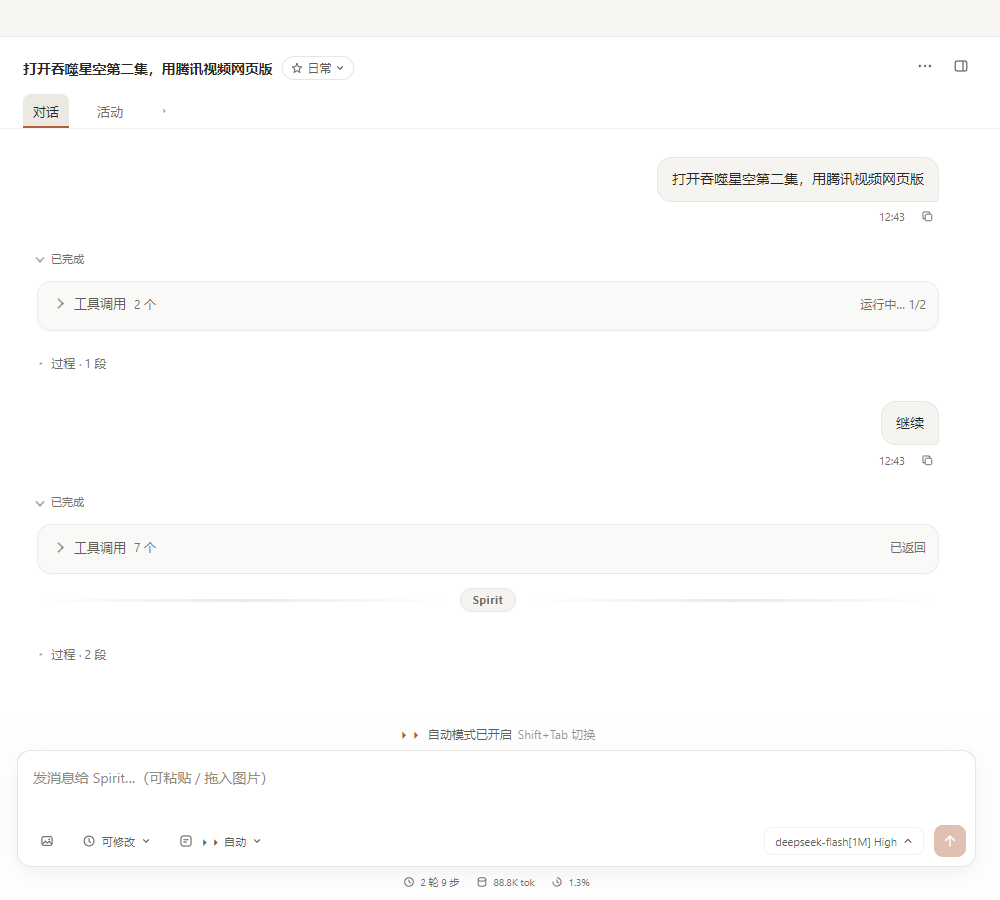
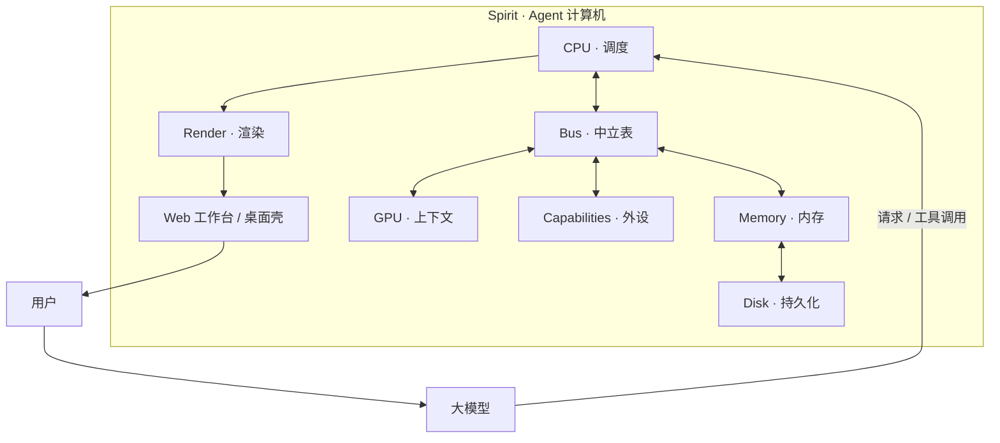

# 一个垃圾的agent开发

> 内部代号 **Spirit**。Agent 不是“一个会调工具的聊天机器人”，而是一台通用计算机 —— 坐在键盘前的人，从「人」换成了大模型。

[English](README.en.md) · [设计文档](spirit/说明/Agent项目构思.md) · [反馈](#反馈)



## 它是什么

Spirit 是一个把大模型当作**计算机使用者**的 Agent 运行时。调度核心、内存、上下文、能力体系、渲染、持久化各自是独立体系，由主板（Engine）装配；能力（bash、文件、网络、浏览器…）像外设一样注册、审批、审计。

自带 Web 工作台和 Electron 桌面壳，也可以在命令行里直接对话。

## 三个差异点

| 设计 | 说明 |
|---|---|
| **Agent = 通用计算机** | 大模型是使用者，不是 CPU；CPU 只做调度。部件之间只走中立表，换掉一个部件，其他部件零改动 |
| **按 10 倍负载设计** | 轮内检查点、断流重试、冷热分层、多会话真并行、有界队列 + 降级；不是“演示能跑” |
| **内核有测试** | 100+ 个离线 Python 测试 + Playwright UI 测试，覆盖并发、超时、取消、坏配置、长跑浸泡 |

## 架构



| 体系 | 职责 |
|---|---|
| CPU / DC | 单线程调度：状态、控制信号、循环 |
| Bus | 体系之间交换资源的唯一通道（中立表） |
| Memory / Disk | 按地址存记录；会话、日志、产物、上传持久化 |
| GPU | 给模型看的上下文：组装、清洗、预算、摘要 |
| Capabilities | 外设：bash、文件、网络、浏览器、数据处理 |
| Scenarios | 提示词增量 + 能力白名单 + 安全默认值 |
| Render / WebUI / Desktop | 给人看的流式输出与操作界面 |

详细设计见 [`spirit/说明/`](spirit/说明/)：
[设计思想](spirit/说明/Agent项目构思.md) ·
[当前实现与边界](spirit/说明/项目体系说明.md) ·
[体系归属规则](spirit/说明/体系总表.md)

## 快速开始

需要 **Python 3.11+**；桌面壳需要 **Node.js 20+**。

```bash
cd spirit
python -m venv .venv
# Windows: .venv\Scripts\activate
# Linux/macOS: source .venv/bin/activate
pip install -e .

cp config.example.json config.json   # 然后填入模型 Base URL / API Key / 模型 ID
python -m MoBo.main web              # Web 工作台：http://127.0.0.1:5000
python -m MoBo.main                  # 命令行对话
```

桌面壳：

```bash
cd desktop
npm install
npm run start
```

> `llm.api_key` 也可以留空，改用环境变量：在 `llm.api_key_env` 里写变量名（默认 `DEEPSEEK_API_KEY`）。

## 能力与场景

所有场景共享：`bash`、文件读写/检索、`view_image`、`http_request`、进程管理、待办、`web_search`、`browser`、数据解析、打包解包、资产写入。

| 场景 | 额外能力 |
|---|---|
| **daily** | DNS、HTTP 探活、抓取、文件查找、进程列表 |
| **pentest** | 沙箱执行、FOFA/Quake/Hunter、子域收集、ffuf、naabu、nuclei、gau |

场景 = 提示词增量 + 能力白名单 + 安全默认值，切换只在轮次边界生效。新增场景只需复制一个文件夹，详见 [`spirit/Scenarios/README.md`](spirit/Scenarios/README.md)。

## 测试

```bash
python tests/python/spirit_kernel_brutal_test.py   # 离线内核测试
node tests/playwright/spirit_layout_ui.js          # UI 测试（需 playwright）
```

测试默认以仓库内 `spirit/` 为引擎根，可用 `SPIRIT_SOURCE` / `SPIRIT_PY` 覆盖。详见 [`tests/README.md`](tests/README.md)。

## 反馈

- **优先提 [Issue](https://github.com/vvvvvv765/a-garbage-agent-dev/issues)**：问题、建议、使用疑问都可以，公开可检索。
- 也可以发邮件：**Spirit.mannn@proton.me**

反馈时请附上三样，能定位的快很多：

1. 症状：你做了什么 → 期望什么 → 实际发生了什么
2. 版本信息：`desktop/version.json` 或「关于 Spirit」里显示的版本
3. 日志：最后 200 行左右就够（**发之前请把 API Key 删掉**）

## 安全声明

**Spirit 会在本机执行大模型生成的命令，默认不逐条确认。**

- 只在你拥有或已获得明确授权的环境中使用。
- 模型可能犯错，也可能被提示注入利用；运行前请确认工作范围与审批模式。
- `config.json` 里是明文 API Key，且被 `.gitignore` 排除；不要提交、不要外传。
- 本项目按 MIT 许可“按原样”提供，不对使用后果作任何担保。

## 已知限制

- 桌面壳与部分能力（bash、路径规则）以 Windows 为第一目标；引擎核心跨平台。
- 浏览器能力依赖外部 ego lite，需自行安装；未安装时相关能力不可用。
- 外部工具、字典、nuclei 模板、便携 bash **不随仓库分发**，需自行准备并遵守各自许可。
- 配置、会话、日志都是本地明文文件；不要在多用户机器上共享数据目录。
- UI 测试依赖本机 Electron / Playwright 环境，部分用例面向打包产物。
- 个人项目，仍在开发，接口和行为可能变化。

## 第三方与许可

- 供应商预设与部分交互行为参考 [cc-switch](https://github.com/farion1231/cc-switch)（MIT）
- Markdown 解析使用 DeepSeek Harness 的 `marked.esm.js`（MIT，许可文件随附）
- 完整说明见 [`THIRD_PARTY_NOTICES.md`](THIRD_PARTY_NOTICES.md)

本项目以 [MIT](LICENSE) 许可发布。
